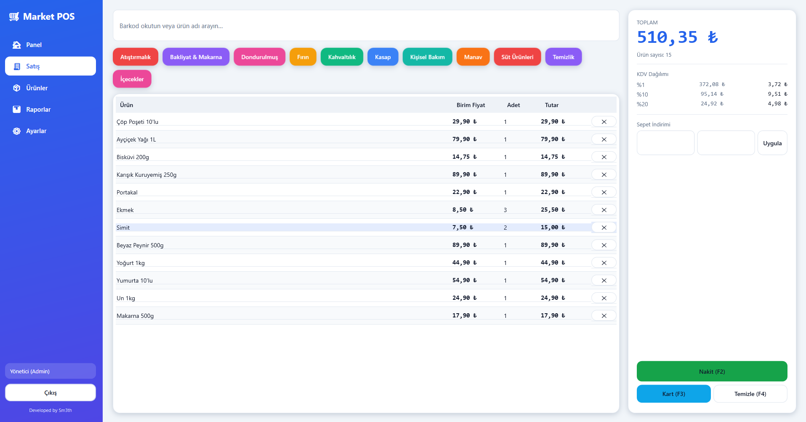
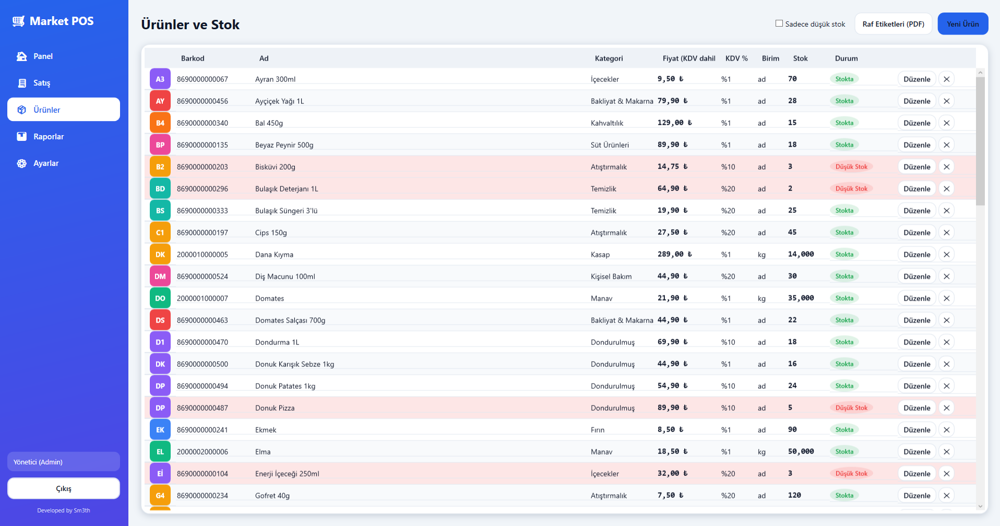

# 🛒 Supermarket POS (Yazar Kasa)

A real, object-oriented **point-of-sale** desktop application for a small supermarket — scan products, build a cart, apply discounts, take payment, print a TR-style receipt, and decrement stock — backed by an admin area for products, inventory, sales history and end-of-day reports.

Local-only (SQLite), no internet required. Ships as a single-file Windows `.exe`.

> Built with correctness as the headline requirement: **money is `decimal` everywhere**, VAT (KDV) is extracted from KDV-inclusive shelf prices, and all rounding is 2-decimal *away-from-zero*. The pricing/VAT/discount/change logic is unit-tested.

---

## Screenshots

| Register (POS) | Products & Inventory | Reports (X/Z) |
|---|---|---|
| __ | __ | __ |

*(placeholders — drop screenshots into `docs/`)*

---

## Features

- **Register / POS** — barcode scan or name search, editable cart (pieces & weighed kg items), per-line and whole-cart discounts, live totals + per-rate VAT breakdown, cash (with live change) or simulated card payment, on-screen + PDF receipt, automatic stock decrement.
- **Products & Inventory (Admin)** — CRUD products & categories, set price/VAT/stock, restock, **low-stock highlighting**.
- **Sales & Reports (Admin)** — date-filtered sales history, open any receipt, **X-report** (running day totals) and **Z-report** (end-of-day close) with VAT breakdown and cash/card split, export reports to PDF.
- **Settings (Admin)** — store name/address (receipt header), language, low-stock threshold, configurable KDV rate list.
- **i18n** — Turkish (default) + English, switchable at runtime; no hardcoded user-facing strings (all from `.resx`).
- **Auth & roles** — BCrypt-hashed passwords, Cashier vs Admin gating.
- **Keyboard-first register** — `Enter` adds the scanned item, `F2` cash, `F3` card, `F4` clear cart discount.

---

## Architecture

Clean, layered OOP with dependencies pointing inward. **The domain depends on nothing.**

```
SupermarketPos.Wpf            Presentation — WPF + MVVM (Views/ViewModels), DI composition root
        │
        ▼
SupermarketPos.Application    Use-cases — service interfaces + implementations, DTOs
        │
        ▼
SupermarketPos.Domain         Entities, value objects, enums, domain rules — NO framework deps

SupermarketPos.Infrastructure EF Core DbContext, repositories, migrations, seed, QuestPDF receipts
   (implements Application/Domain abstractions; referenced only by the composition root)
```

**Why these layers?** Business rules (stock invariants, VAT/discount math, change calculation) live in the
framework-free **Domain**, so they are trivially unit-testable and cannot be corrupted by UI or DB concerns.
The **Application** layer expresses use-cases against interfaces (`IProductRepository`, `ISaleService`, …).
**Infrastructure** supplies the concrete EF Core / QuestPDF implementations, and the **WPF** project is just a
thin, bindable shell wired together by dependency injection in `App.xaml.cs`.

Highlights:
- **Polymorphism #1 — Discounts** (`Discount` → `PercentageDiscount`, `FixedAmountDiscount`), a Strategy.
- **Polymorphism #2 — Payments** (`Payment` → `CashPayment`, `CardPayment`).
- **Single source of truth for money** — `PricingService` does every total, VAT extraction and discount distribution.
- Domain invariants enforced inside entities (can't sell more than stock, qty > 0, tendered ≥ total, etc.).

---

## Tech stack

- **C# / .NET 8**, **WPF** + **MVVM** (CommunityToolkit.Mvvm)
- **Entity Framework Core 8** + **SQLite** (migrations + seed)
- **Microsoft.Extensions.DependencyInjection** (composition root)
- **QuestPDF** (receipts & report PDFs)
- **BCrypt.Net** (password hashing)
- **xUnit** + **FluentAssertions** (tests)

---

## Getting started

```bash
# restore + build
dotnet build

# run the test suite (pricing/VAT/discount/change/stock/auth/receipt-no)
dotnet test

# run the app (Windows)
dotnet run --project src/SupermarketPos.Wpf
```

### Default logins
| Role | Username | Password |
|------|----------|----------|
| Admin | `admin` | `admin` |
| Cashier | `kasa` | `1234` |

> The seeded passwords are for first-run only — change them in a real deployment.

### Where is the database?
A SQLite file is created on first run at:

```
%LOCALAPPDATA%\SupermarketPos\pos.db
```

It is migrated and seeded automatically (categories, ~15 products with mixed KDV rates, the two accounts, store settings).

---

## Publish to a single `.exe`

```bash
dotnet publish src/SupermarketPos.Wpf/SupermarketPos.Wpf.csproj -c Release -r win-x64 ^
  --self-contained true ^
  -p:PublishSingleFile=true ^
  -p:IncludeNativeLibrariesForSelfExtract=true ^
  -p:EnableCompressionInSingleFile=true
```

Output: `src/SupermarketPos.Wpf/bin/Release/net8.0-windows/win-x64/publish/SupermarketPos.exe`
(a self-contained, ~70 MB single file — no .NET install required on the target machine). Double-click to run.

---

## How VAT & pricing work

Turkish retail convention: the shelf/`UnitPrice` is **KDV-inclusive** (gross). To avoid rounding drift,
VAT is **extracted from the inclusive gross, grouped by rate**:

```
gross = Σ line gross (per rate)         // after line discounts
net   = round2(gross / (1 + rate))      // pre-tax base
vat   = round2(gross - net)             // tax portion
```

All money is `decimal`; every rounding is `Math.Round(x, 2, MidpointRounding.AwayFromZero)`.
A **whole-cart discount** is distributed across lines *proportionally to their gross* before VAT extraction,
and the rounding residual is parked on the largest line so the parts always sum exactly to the discounted total.
VAT rates are **not hardcoded** — they live on each product and in Settings (defaults: Turkey's 1% / 10% / 20%).

Example: a `120,00 ₺` item at 20% KDV → net `100,00 ₺`, VAT `20,00 ₺`. Cash tendered `150,00 ₺` → change `30,00 ₺`.

---

## License

[MIT](LICENSE)
